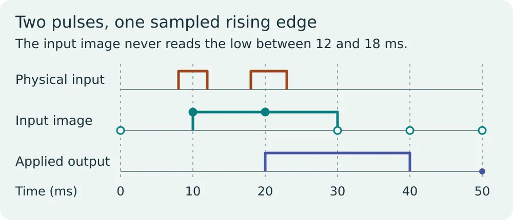
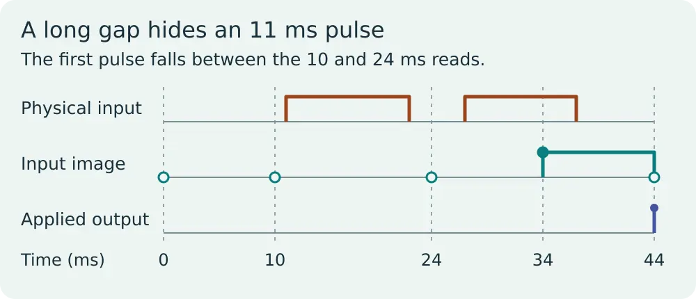

# PLC scan cycle: find missed digital pulses

Run an offline timing trace for one digital input and one simulated output. The complete lesson, with timing diagrams and a worked example, is at [WIFA Robotics](https://wifarobotics.com/learn/plc-scan-cycle/).

## Start from zero

1. Install Python 3.10 or newer from [python.org](https://www.python.org/downloads/). On Linux, your distribution's Python 3 package is also suitable. Check with `python3 --version` (macOS/Linux) or `py -3 --version` (Windows).
2. On the repository page choose **Code → Download ZIP** and extract it. Open a terminal in the extracted directory, where `scan.py` is visible. Alternatively, if you already have Git, run `git clone https://github.com/williamfarokhzad/wifa-plc-scan-cycle.git`, then `cd wifa-plc-scan-cycle`.
3. No packages, virtual environment or PLC connection are needed. On Windows replace `python3` with `py -3`.

```sh
python3 scan.py examples/phase.json
python3 scan.py examples/merged.json
python3 scan.py examples/gap.json
python3 -m unittest discover -s tests -v
```

| File | Largest sample gap | Observed pulses | Rising edges in the sampled image |
| --- | ---: | ---: | ---: |
| phase.json | 10 ms | 2 of 3 | 1 |
| merged.json | 10 ms | 2 of 2 | 1 |
| gap.json | 14 ms | 1 of 2 | 1 |

In the merged case the sample first goes high at 10 ms, the applied output first goes high at 20 ms, and the sample first returns low at 30 ms. The output returns low at 40 ms. The original input dropped from 12 to 18 ms, but there was no sample there.





## Make a scenario

Copy one example. Use whole milliseconds. In `sample_ms`, list two or more increasing reads. In `pulses_ms`, list sorted pairs `[start,end]`; the input is high at the start and low again at the end. Leave a positive low interval between pulses, start after the first read, and end no later than the last read. The simulator starts with an output image of zero. It emits `null` for a pulse no read saw. The complete trace shows the old output image applied, the sampled input, a rising edge in that input image, and the output image computed for next time.

For a quick experiment, move the first pulse in `phase.json` from `[3,7]` to `[8,12]`. Both are four milliseconds wide. The first read of that pulse changes from `null` to 10 ms.

## Troubleshoot and verify

* **Cannot open file:** check you are in the extracted project folder; run `ls` or Windows `dir` to find `scan.py`.
* **Invalid JSON or duplicate key:** copy a supplied example and edit only the values. JSON does not allow trailing commas.
* **Different pulse and edge counts:** inspect the intervening low interval. A rising edge in the sampled image requires a sampled low before the next sampled high.
* **Unexpected delay:** compare `input_image` at the current read with `applied_output` at the next read. The program only copies the input into the pending output image.
* **Tests:** the nine tests cover interval boundaries, output order, every integer phase for 19 cycle lengths, invalid inputs and 400 seeded traces compared with an independent per millisecond oracle. Rebuild editable SVGs with `python3 diagrams/render.py`; WebP files are optimized exports. To reproduce the export pipeline, render the SVG to PNG with Inkscape and export the original and 600 px variants using ImageMagick at qualities 88 and 86, respectively.

## Scope and references

This is a discrete timing model with synthetic pulses. It neither connects to a PLC nor models input filter delay, network and task scheduling, interrupt priorities, device timing or output hardware. It is not an implementation of a safety function. The model uses one explicitly chosen ordering: apply the old output image, read inputs, run the program. Check the specific device and configuration before applying the reasoning to equipment.

* [Siemens STEP 7 V21: Cyclic OBs on S7-1200](https://docs.tia.siemens.cloud/r/en-us/v21/functional-description-of-s7-1200-cpus-s7-1200/organization-blocks-s7-1200/cyclic-obs-s7-1200)
* [Beckhoff: Sampling of digital inputs](https://infosys.beckhoff.com/content/1033/ep1258/18431834123.html)
